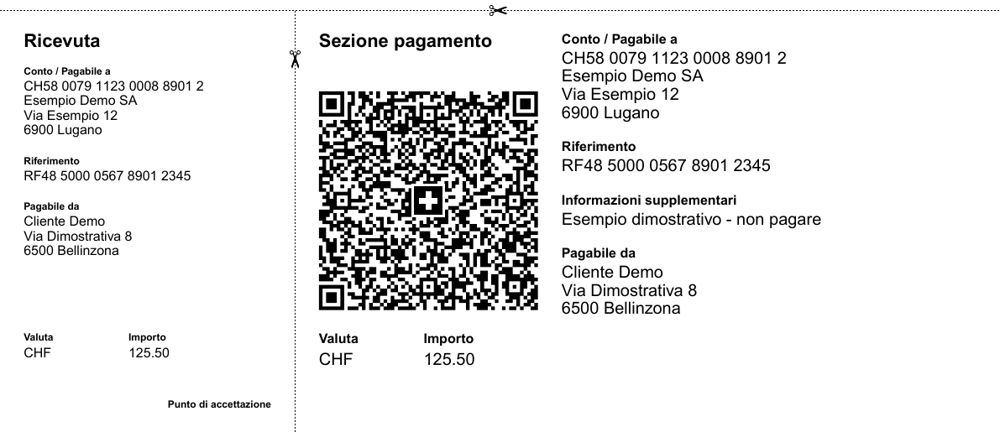

<h1 align="center">Swiss QR Bill Skill</h1>

<p align="center"><strong>Da un file JSON a un bollettino di pagamento svizzero in PDF.</strong></p>

<p align="center">
  Codex · Claude Code · Node.js 22+ · MIT
</p>

<p align="center">
  <a href="#prova-la-demo">Prova la demo</a> ·
  <a href="#installa-la-skill">Installa la skill</a> ·
  <a href="examples/demo.pdf">Apri il PDF di esempio</a>
</p>

<p align="center">
  <a href="examples/demo.pdf"></a>
</p>

<p align="center"><sub>Dettaglio del bollettino con dati dimostrativi. Il PDF completo è in formato A4.</sub></p>

La skill prepara i dati per il generatore. Lo script verifica IBAN, importo e riferimento prima di produrre un PDF con ricevuta e sezione di pagamento. Puoi usare lo stesso script da terminale, anche senza un agente.

## Prova la demo

Servono Node.js 22 o successivo e npm.

```sh
git clone https://github.com/stedbrown/swiss-qr-bill-skill.git
cd swiss-qr-bill-skill/swiss-qr-bill
npm ci --ignore-scripts
node scripts/generate.mjs examples/demo.json demo.pdf
```

Il comando crea `demo.pdf` nella cartella corrente. Per stamparlo, scegli **dimensioni effettive (100%)**. Per ripetere il comando, scegli un nuovo nome per il PDF.

## Installa la skill

Copia la cartella [`swiss-qr-bill/`](swiss-qr-bill/) nel percorso adatto e installa le dipendenze nella copia con `npm ci --ignore-scripts`.

| Ambiente | Percorso nel progetto | Come richiamarla |
| --- | --- | --- |
| [Codex](https://developers.openai.com/codex/skills) | `.agents/skills/swiss-qr-bill/` | `$swiss-qr-bill` |
| [Claude Code](https://code.claude.com/docs/en/skills) | `.claude/skills/swiss-qr-bill/` | `/swiss-qr-bill` |

> Usa la skill swiss-qr-bill per generare un bollettino dai dati di `pagamento.json`. Salvalo come `pagamento.pdf`.

In ChatGPT desktop puoi usarla dalla modalità Codex. Per distribuirla in Chat e Work sul web serve un pacchetto plugin. [Guida OpenAI](https://learn.chatgpt.com/docs/build-skills)

## Usa i tuoi dati

Parti dal [JSON di esempio](swiss-qr-bill/examples/demo.json). Tieni i dati reali fuori dal repository e passa allo script il percorso del JSON e quello del PDF. La cartella di destinazione deve già esistere.

| Campo | Valore atteso |
| --- | --- |
| `creditor` | `account` (IBAN CH o LI), `name`, `zip`, `city`, `country`. `address` e `buildingNumber` sono facoltativi. |
| `debtor` | Facoltativo. Stessi campi dell'indirizzo del creditore, senza `account`. |
| `currency` | `CHF` o `EUR`. Per EUR serve un IBAN ordinario. |
| `amount` | Numero facoltativo da 0.01 a 999999999.99, con un massimo di due decimali. Se omesso, il PDF lascia lo spazio per scriverlo. |
| `reference` | Con QR-IBAN serve un riferimento QR di 27 cifre. Con IBAN ordinario è facoltativo e, se presente, deve essere un riferimento SCOR ISO 11649. |
| `message` | Facoltativo, fino a 140 caratteri su una riga. |
| `language` | `IT` (predefinito), `DE`, `FR`, `EN` o `RM`. |

Scrivi CAP, numeri civici e riferimenti come stringhe per conservare gli zeri iniziali. Ometti i campi facoltativi vuoti. Il testo supporta i caratteri ASCII stampabili e un sottoinsieme di lettere latine e segni di punteggiatura.

Il generatore produce un bollettino per esecuzione. Per aggiungere intestazione, righe e IVA, consulta la [guida SwissQRBill alle fatture complete](https://github.com/schoero/swissqrbill/blob/main/docs/how-to-create-a-complete-qr-bill.md). Prima di emettere il bollettino, verifica le coordinate del beneficiario e confronta i dati letti dal QR con quelli attesi. [Specifiche QR-bill di SIX](https://www.six-group.com/en/products-services/banking-services/payment-standardization/standards/qr-bill.html)

## Test e licenza

Esegui `npm test` dalla cartella `swiss-qr-bill/`. I test coprono la generazione del PDF, la protezione dalla sovrascrittura e il rifiuto di dati errati, incluso il checksum SCOR del caso [SwissQRBill #487](https://github.com/schoero/swissqrbill/issues/487).

Il progetto è distribuito con licenza [MIT](LICENSE). Usa [SwissQRBill](https://github.com/schoero/swissqrbill) e [PDFKit](https://pdfkit.org/), con versioni fissate nel lockfile.
